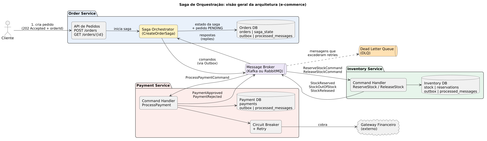
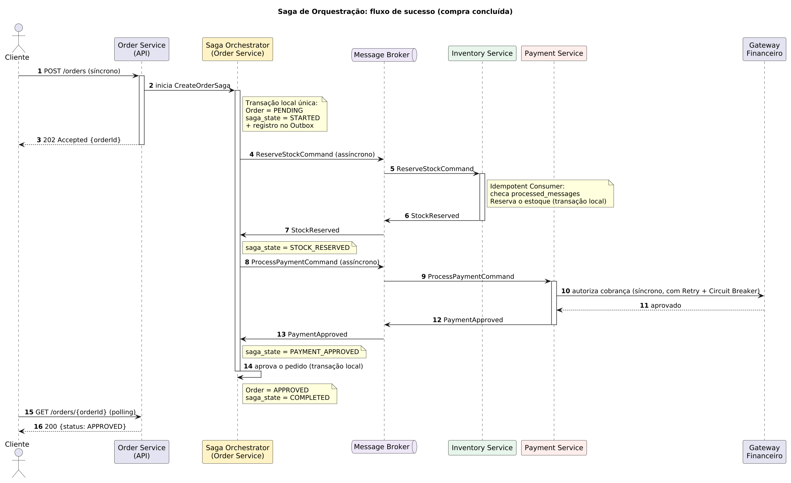
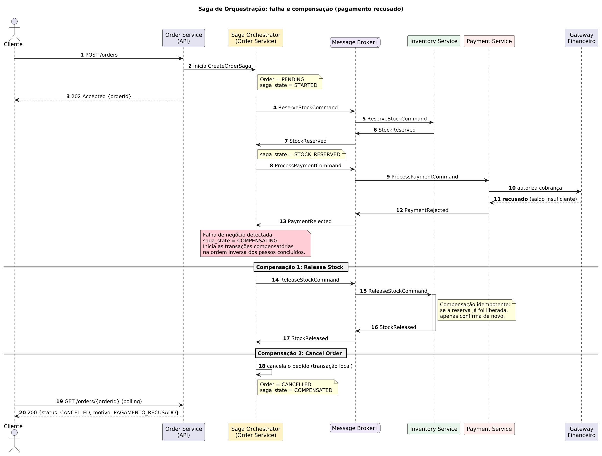

# Saga de Orquestração para o fluxo de compra de um e-commerce

Blueprint de arquitetura para a migração de um monólito de comércio eletrônico para microsserviços, usando o padrão **Saga** para garantir consistência eventual no fluxo de compra.

> Esta entrega contém apenas a especificação arquitetural (diagramas e documentação). Não há código de aplicação.

## 1. Contexto de negócios

A empresa está migrando o seu monólito de e-commerce para uma arquitetura distribuída. O fluxo crítico de compra passa por três domínios desacoplados, cada um com a sua própria base de dados (padrão *Database per Service*):

| Serviço | Responsabilidade |
|---|---|
| **Order Service** | Registrar e gerenciar o ciclo de vida do pedido |
| **Inventory Service** | Gerenciar o estoque e realizar reservas temporárias |
| **Payment Service** | Processar o pagamento com gateways financeiros externos |

Como não existe mais um banco único, uma transação ACID tradicional não atravessa os três serviços, e o *two-phase commit* (2PC) foi descartado por acoplar os serviços e reduzir a disponibilidade. A solução adotada é uma **Saga**: uma sequência de transações locais, em que cada falha de negócio dispara **transações compensatórias** que desfazem o que as etapas anteriores já confirmaram.

## 2. Estilo escolhido: Orquestração

**Decisão: Saga baseada em Orquestração**, com o orquestrador (`CreateOrderSaga`) hospedado no Order Service.

### Justificativa

- **Fluxo com ordem rígida e compensações encadeadas.** A compra segue uma sequência clara (reservar estoque, cobrar, aprovar) e, quando falha, as compensações precisam ocorrer na ordem inversa. Um orquestrador central concentra essa lógica em um único lugar, em vez de espalhá-la em reações a eventos.
- **Acoplamento.** Os participantes (Inventory e Payment) não conhecem uns aos outros nem o fluxo completo: só recebem comandos e devolvem respostas. Na coreografia, cada serviço precisaria conhecer os eventos dos demais, e o acoplamento por eventos cresce a cada novo passo.
- **Complexidade.** Com três serviços a coreografia ainda seria viável, mas o fluxo tende a crescer (antifraude, frete, notificação). Na orquestração, adicionar um passo é alterar a definição da saga; na coreografia, é alterar vários consumidores e o risco de ciclos de eventos aumenta.
- **Observabilidade e depuração.** O estado da saga fica em uma tabela (`saga_state`), o que responde de imediato "em que passo esse pedido está?". Na coreografia, essa resposta exige reconstruir a história a partir de vários logs.
- **Escalabilidade.** O orquestrador não processa regra de negócio dos outros domínios: apenas coordena. Ele escala horizontalmente porque o estado fica no banco, e o trabalho pesado continua nos serviços participantes.
- **Trade-off assumido.** O orquestrador é um ponto de atenção (risco de virar um "serviço Deus" ou ponto único de falha). Isso é mitigado mantendo-o sem regra de negócio, com estado persistido e várias instâncias (detalhes em [`docs/decisoes-arquiteturais.md`](docs/decisoes-arquiteturais.md)).

### Matriz de decisão: Orquestração vs. Coreografia

Notas de 1 (ruim) a 5 (ótimo) para o contexto deste projeto.

| Critério | Peso | Orquestração | Coreografia |
|---|:-:|:-:|:-:|
| Clareza do fluxo e das compensações | 25% | 5 | 2 |
| Baixo acoplamento entre participantes | 20% | 4 | 3 |
| Facilidade de evolução (novos passos) | 15% | 4 | 2 |
| Observabilidade e depuração | 20% | 5 | 2 |
| Simplicidade de infraestrutura | 10% | 3 | 4 |
| Ausência de ponto central | 10% | 3 | 5 |
| **Total ponderado** | 100% | **4,25** | **2,70** |

## 3. Diagramas

Os arquivos editáveis (PlantUML) ficam ao lado dos PNGs em [`diagrams/`](diagrams/).

### 3.1 Visão geral da arquitetura



Mostra os três serviços, cada um com seu banco, o orquestrador dentro do Order Service, o barramento de mensagens (Kafka ou RabbitMQ), a Dead Letter Queue e o gateway financeiro externo. Cada banco possui as tabelas de apoio `outbox` (publicação confiável de mensagens) e `processed_messages` (consumidor idempotente).

### 3.2 Fluxo de sucesso



1. O cliente chama `POST /orders` (**síncrono**) e recebe `202 Accepted` com o `orderId`, pois o resultado final é assíncrono.
2. Em **uma única transação local**, o Order Service grava o pedido como `PENDING`, o estado da saga como `STARTED` e o comando no Outbox.
3. O orquestrador envia `ReserveStockCommand` (**assíncrono**). O Inventory reserva o estoque e responde `StockReserved`.
4. O orquestrador envia `ProcessPaymentCommand` (**assíncrono**). O Payment chama o gateway (**síncrono**, protegido por Retry e Circuit Breaker) e responde `PaymentApproved`.
5. O orquestrador aprova o pedido (`APPROVED`) e marca a saga como `COMPLETED`.
6. O cliente consulta o resultado com `GET /orders/{orderId}` (polling).

### 3.3 Fluxo de falha e compensação



Cenário exigido: o Payment Service **recusa o pagamento depois** de o Inventory Service já ter reservado o produto.

1. O Payment responde `PaymentRejected` e o orquestrador muda a saga para `COMPENSATING`.
2. **Compensação 1, Release Stock:** o orquestrador envia `ReleaseStockCommand` e o Inventory devolve a quantidade ao estoque disponível (`StockReleased`).
3. **Compensação 2, Cancel Order:** o orquestrador cancela o pedido localmente (`CANCELLED`) e marca a saga como `COMPENSATED`.
4. O cliente passa a ver `CANCELLED` com o motivo `PAGAMENTO_RECUSADO`.

### Catálogo de transações e compensações

| # | Transação local | Serviço | Compensação | Tipo |
|---|---|---|---|---|
| T1 | Criar pedido `PENDING` | Order | **Cancel Order** | Compensável |
| T2 | Reservar estoque | Inventory | **Release Stock** | Compensável |
| T3 | Processar pagamento | Payment | Estorno (`RefundPayment`) apenas se o pagamento for confirmado depois de a saga já ter compensado | *Pivot* |
| T4 | Aprovar pedido | Order | Não há (repetida até concluir) | *Retriable* |

## 4. Idempotência e tolerância a falhas

Como o barramento entrega mensagens **pelo menos uma vez** (*at-least-once*), duplicatas e reentregas são esperadas e precisam ser inofensivas.

### 4.1 Idempotent Consumer

Todo comando, resposta e evento carrega um `messageId` único (UUID) e o `sagaId`. Cada serviço mantém uma tabela `processed_messages`:

| Coluna | Descrição |
|---|---|
| `message_id` (PK) | Identificador único da mensagem |
| `consumer` | Nome do handler que processou |
| `processed_at` | Momento do processamento |
| `result` | Resposta gerada (para reenviá-la em caso de duplicata) |

Ao receber uma mensagem, o handler, **dentro da mesma transação local** que aplica o efeito de negócio:

1. tenta inserir o `message_id` em `processed_messages` (a chave primária impede duas inserções);
2. se já existe, **não reaplica o efeito** e apenas reenvia a resposta guardada em `result`;
3. se não existe, aplica o efeito, grava o `result` e registra a resposta no Outbox.

Como o registro de controle e o efeito de negócio são confirmados juntos, uma queda no meio do caminho nunca deixa um sem o outro. Além disso, as operações são idempotentes por natureza: reservar estoque usa a chave `(order_id, sku)`, e cobrar usa uma **chave de idempotência** enviada ao gateway, evitando cobrança duplicada.

### 4.2 Tabela de controle de estado da Saga

Tabela `saga_state`, no banco do Order Service:

| Coluna | Descrição |
|---|---|
| `saga_id` (PK) | Identificador da saga (também usado como *correlation id*) |
| `order_id` | Pedido associado |
| `status` | `STARTED`, `STOCK_RESERVED`, `PAYMENT_APPROVED`, `COMPLETED`, `COMPENSATING`, `COMPENSATED`, `NEEDS_ATTENTION` |
| `current_step` | Passo em andamento |
| `step_deadline` | Prazo limite para a resposta do passo atual |
| `retry_count` | Tentativas já feitas no passo |
| `version` | Controle de concorrência otimista |
| `updated_at` | Última atualização |

### 4.3 Timeouts de rede

Quando o orquestrador envia um comando, ele grava um `step_deadline`. Um *job* periódico procura sagas em andamento com prazo vencido:

1. **Reenvio:** reenvia o mesmo comando (mesmo `messageId`), o que é seguro porque o consumidor é idempotente. O intervalo cresce com *backoff* exponencial e `retry_count` é incrementado.
2. **Esgotadas as tentativas** (ex.: 5):
   - Em **reserva de estoque**: inicia a compensação (`Cancel Order`).
   - Em **pagamento**: o timeout é ambíguo (o gateway pode ter cobrado e a resposta se perdeu). Antes de compensar, o Payment **consulta o status** da cobrança pela chave de idempotência. Se estiver aprovada, a saga segue; se recusada ou inexistente, compensa; se continuar indefinida, a saga vai para `NEEDS_ATTENTION` e gera alerta para operação.
3. **Respostas tardias** (que chegam depois da compensação) são descartadas pelo orquestrador ao comparar com o `status` e a `version` da saga, e, se for um pagamento aprovado tardio, dispara o estorno.

## 5. Estrutura do repositório

```
.
├── README.md
├── diagrams/
│   ├── saga-architecture-overview.png
│   ├── saga-architecture-overview.puml
│   ├── sequence-success-flow.png
│   ├── sequence-success-flow.puml
│   ├── sequence-compensation-flow.png
│   └── sequence-compensation-flow.puml
└── docs/
    └── decisoes-arquiteturais.md
```

Para editar os diagramas: abra os arquivos `.puml` no PlantUML (extensão do VS Code ou https://www.plantuml.com/plantuml) e exporte novamente em PNG.

## 6. Referências

- Chris Richardson, *Pattern: Saga*. https://microservices.io/patterns/data/saga.html
- Chris Richardson, *Pattern: Transactional Outbox*. https://microservices.io/patterns/data/transactional-outbox.html
- Chris Richardson, *Pattern: Database per Service*. https://microservices.io/patterns/data/database-per-service.html
